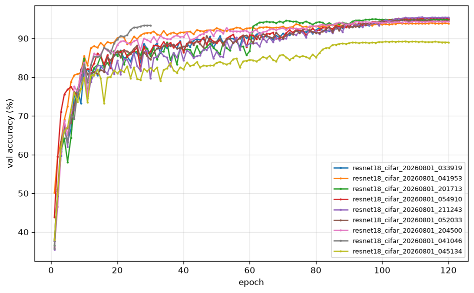
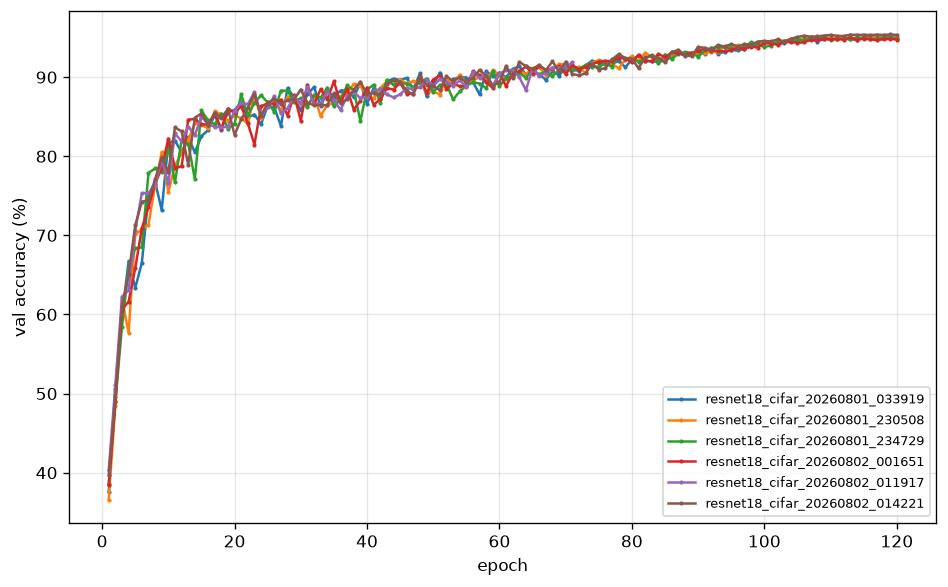
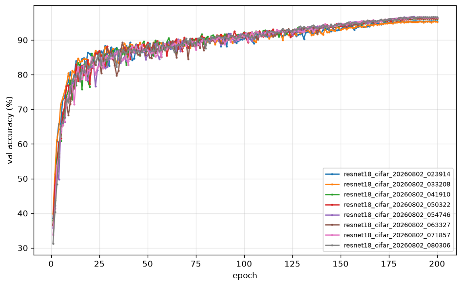

# EXPERIMENTS.md — Ablation ledger

Every training run that informs a decision gets a row here. A result you can't point to a row for doesn't count.

**Rules**
- One row per run, added when the run *finishes*, not when it's planned.
- `val_acc` is best val accuracy across epochs. Test accuracy appears only for the final model.
- Every row links to its run directory and config hash so it can be rebuilt.
- Rows that fell outside their expected band get a hypothesis in the Notes column. A surprise is data.
- Regenerate a table with `python scripts/make_report.py --all --section <id>` rather than hand-editing.
  It rewrites only between that section's `BEGIN/END GENERATED` markers; prose outside them is safe.
- **Within a sweep, the `Min` and `s/epoch` columns are not a cross-run comparison.** `sweep.py` runs
  jobs back to back, so run order is confounded with GPU temperature — the ninth run starts on a card
  the first eight have been heating, and a 12-epoch run has already been watched drift 36.2 → 40.8
  s/epoch as it warmed. **Only the accuracy columns compare across rows.** Read `GPU C in/out` before
  reading any timing column, and re-measure a timing claim as a standalone run.
- **A wrong run is retracted, never deleted.** Add `"retracted": {"reason": "...", "date": "..."}` to
  its `run_manifest.json`; the row then renders struck through with the reason still visible. A row
  that silently vanishes is worse than a wrong one in a document whose whole job is being checkable.

---

## Hardware

Fill in once, in Sprint 3, so every timing below is interpretable.

| GPU | VRAM | CPU | PyTorch | CUDA | OS |
|---|---|---|---|---|---|
| NVIDIA RTX 4060 Laptop | 8 GB | i7-14700HX | 2.11.0+cu128 | 12.8 | Windows 11 |

Laptop GPU — record whether the machine was plugged in and on the "Best performance" power profile, since thermal throttling on runs over an hour is the main source of timing variance between otherwise identical runs.

**Sprint 3 conditions:** plugged in, Best-performance profile. Under sustained load the GPU held 2580 MHz at 65–68 °C with no throttle flags set; an fp16 4096³ matmul benchmarked at 28.9 TFLOPS, so the card is delivering its clocks. No run in this sprint exceeded 4 minutes, so none of these numbers carry thermal decay.

### Measured epoch times — RUN-LEVEL

Batch 128, AMP on, `channels_last` off (ADR-007). **Run-level**: a real training run, validation and
checkpoint writes and logging included. ADR-007's table is **per-step** and is not comparable with
this one — see `PRD.md` §5. Steady state is the median of a run's back half, not
everything-but-the-first-epoch (see "the ramp is not one epoch" below).

| Model | s/epoch (steady) | Across sessions | First epoch | Measured over |
|---|---|---|---|---|
| SimpleCNN | 4.4 / 6.4 | ±20%, **not reproducible** | 62–73 s | 30 ep (sprint 3), 14 ep ×2 (sprint 4) |
| ResNet-18-CIFAR | **13.8** | ±4% (13.2–14.2) | 80–86 s | 5 ep (sprint 3), 10 + 12 ep (sprint 4) |

The first epoch costs an extra 60–75 s on Windows: `num_workers=4` on both the train and val loaders means eight worker processes spawn and each unpickles its own copy of the CIFAR-10 split. Fixed per run, so it matters at 30 epochs and disappears at 300.

**The ramp is not one epoch.** ResNet-18 settles by epoch 3; SimpleCNN takes until roughly epoch 7 —
the sprint-3 gate run went 65.6, 8.4, 7.0, 5.2, 4.7, 4.3, then flat at 4.3–4.4 for the remaining 24.
Any run shorter than ~10 epochs reports a ramp-inflated number no matter how the median is taken.

**SimpleCNN cannot be used as a timing instrument.** Identical config and commit measured 4.4 s/epoch
in one session and 6.4 in the next. ResNet-18 varied ±4% over the same period. Likely GPU boost
state — ResNet-18 saturates the card, SimpleCNN never draws enough to leave a lower power state, so
its epoch time depends on what ran before it. Run performance A/Bs on ResNet-18.

---

## Sprint 3 — Baseline

| ID | Run | Config hash | Model | Epochs | Val acc | Test acc | Min | Notes |
|---|---|---|---|---|---|---|---|---|
| E0 | `runs/simple_cnn_20260801_004212` | `939482835ef3` | simple_cnn | 30 | **93.02** (best, ep 27) | 91.55 | 3.3 | Gate M4 (≥85%) passed by 8 points. Final-epoch val 92.60 / test 91.76. |

## Sprint 5 — The 94% recipe

**The numbers live in the generated `sprint-5` region at the bottom of this file.** This block is the
ID map only, so that "E4" means something stable in prose without duplicating a figure that a
regeneration would then silently disagree with.

| ID | Config | Hash | Change from full recipe |
|---|---|---|---|
| **F** | `resnet18.yaml` | `3b1347d7678d` | — full recipe — |
| E1 | `abl_adam` | `80f6f78140fa` | AdamW 1e-3 instead of SGD |
| E2 | `abl_step_lr` | `16bc07ef3ade` | Step LR (60, 90) instead of cosine |
| E3 | `abl_no_warmup` | `f2da8632ed18` | `warmup_epochs=0` |
| E4 | `abl_wd_on_bn` | `482da61d0efe` | `no_wd_on_bn_bias=false` |
| E5 | `abl_no_smoothing` | `05b2e398ac31` | `label_smoothing=0.0` |
| E6 | `abl_wd_1e4` | `9d29dcb47e98` | `weight_decay=1e-4` |
| E7 | `abl_30ep` | `d27955206ecd` | `epochs=30` |
| E8 | `abl_no_aug` | `64cf2b47d38e` | crop and flip off |

### M1 — the milestone number

**F's test accuracy is 94.60%.** `scripts/eval.py --run runs/resnet18_cifar_20260801_033919
--checkpoint best`, on the best-val checkpoint (epoch 115), 10 000 test images: top-1 **94.60%**,
top-5 99.44%, loss 0.6462. **M1 requires ≥ 94.0%, so M1 is met with 0.60 points of margin.** This is
a measured test number, not an inference from F's val accuracy — no gate in this project may be
settled by subtracting an assumed val/test offset from a val figure.

The rest of the acceptance criteria, for the record: best val **95.08%** against a 94.5% gate (+0.58);
val − test = **0.48%**, inside the 0.5% band that would otherwise mean an unrepresentative split;
wall clock **28.6 min** against M3's 45; 13.19 s/epoch. Only `scripts/eval.py` ever loaded the test
set, once, after training finished.

Per-class, F's floor is cat **88.6%** and dog **90.1%**; every other class is ≥ 92.3%. 59 cat→dog and
64 dog→cat confusions are the single largest error mode, which is the expected CIFAR-10 result and
the thing Sprint 6's augmentation work has the most room to move.

## Sprint 6 — Augmentation

**The numbers live in the generated `sprint-6-step0` and `sprint-6` regions at the bottom of this
file.** This block is the ID map only, on the same principle as Sprint 5's.

The sprint was redesigned on 2026-08-01 from eight single-seed configs to four configs at two
repeats, on the grounds that eight numbers separated by less than the noise floor are eight numbers
nobody can rank. **E11, E12, E14 and E16 were therefore never run** and their IDs are retired rather
than reused — a reader who remembers them should find out what happened to them, which is the same
reason a wrong run is retracted rather than deleted.

| ID | Config | Hash (seed 42 / 1337) | Change from the Sprint 5 recipe |
|---|---|---|---|
| E9 | `aug/e09_baseline` | `e0e15fda06b7` / `049fbaf347e5` | 200 epochs, no new augmentation |
| E10 | `aug/e10_cutout` | `e113dbf2105f` / `91080f1b0aaf` | + Cutout(1, 16) |
| E13 | `aug/e13_cutout_mixup` | `4553d71e9c01` / `9569fe8a2515` | + Cutout + Mixup α=0.2, `batch_aug_prob=1.0` |
| E15 | `aug/e15_randaugment_cutout` | `56ebde55573d` / `a7ddfc7c1853` | + Cutout + RandAugment(2, 9) |
| ~~E11, E12, E14, E16~~ | — | — | Dropped in the redesign; never run |

Step 0's seed-variance runs share the F recipe and carry no new ID: they are `3b1347d7678d`
(seed 42, identical to F), `f7d31e9a78fb` (1337) and `084880933381` (2024).

**Summary — mean ± std over two repeats, val accuracy:**

| Config | seed 42 | seed 1337 | Mean ± std | Δ vs E9 |
|---|---|---|---|---|
| E9 baseline | 95.50 | 95.36 | 95.43 ± 0.10 | — |
| E10 + Cutout | 96.24 | 96.32 | 96.28 ± 0.06 | +0.85 |
| E13 + Cutout + Mixup | 96.70 | 96.54 | 96.62 ± 0.11 | +1.19 |
| **E15 + RandAugment + Cutout** | 96.62 | 96.68 | **96.65 ± 0.04** | **+1.22** |

The gate (≥95.5% val as mean ± std) is met by E10, E13 and E15.

**Test accuracy — E15 only.** E15 was pre-declared the Sprint 7 base in `docs/sprints/06-augmentation.md`
(commit `e63d476`) *before* any test evaluation ran, and both of its seeds were evaluated, not the
better one. E10 and E13 were deliberately **not** evaluated: E10-vs-E15 is the contested comparison,
and measuring both on test and keeping the winner is exactly how a test set stops being one.

| Run | Best val | Final val | Test top-1 | Test top-5 | val − test |
|---|---|---|---|---|---|
| E15 seed 42 (`runs/resnet18_cifar_20260802_071857`) | 96.62 | 96.50 | 95.94 | 99.73 | 0.68 |
| E15 seed 1337 (`runs/resnet18_cifar_20260802_080306`) | 96.68 | 96.64 | 96.17 | 99.75 | 0.51 |
| **Mean ± std** | **96.65 ± 0.04** | — | **96.06 ± 0.16** | — | **0.59** |

Every val figure for E10, E13 and E9 remains a validation number only, and none of them is a test
claim.

## Sprint 7 — Final

| ID | Run | Hash | Setup | Epochs | Seed | Val acc | Test acc | ECE | Min |
|---|---|---|---|---|---|---|---|---|---|
| E17 | | | best aug + EMA | 300 | 42 | | | | |
| E18 | | | best aug + EMA | 300 | 1337 | | | | |
| E19 | | | best aug + EMA | 300 | 2024 | | | | |
| E20 | | | E17 + TTA (hflip) | — | 42 | | | | |
| E21 | | | E17, no label smoothing | 300 | 42 | | | | Calibration comparison |

**Headline result:** _mean ± std over seeds 42/1337/2024, to be filled in Sprint 7._

---

## Candidate ablations

- `random_crop_padding` uses `padding_mode="reflect"` (`build_train_transform`, sprint 1). Zero padding is the
  classic recipe and is worth testing in Sprint 5.
- `channels_last` is off by default (ADR-007) because it measured 2.8× slower here run-level on ResNet-18.
  Re-measure on any other GPU before assuming that still holds — it is one config flag.
- The val loader runs `num_workers=4` to serve ten batches of 512. Four worker spawns almost certainly cost more
  than they save, and they are half of the 60–75 s first-epoch penalty. Worth measuring against `num_workers=0`
  on the eval loaders.

## Findings

**Sprint 3 — the val/test gap is mostly checkpoint selection, not a split bug.** The gate run's best checkpoint scores 93.02% val and 91.55% test, a 1.47% gap wide enough to be worth chasing. Evaluating the *final* checkpoint instead gives 92.60% val and 91.76% test — a 0.84% gap. The difference between the two gaps is the price of picking the best of 30 epochs by val accuracy: roughly 0.6% of apparent accuracy that does not survive contact with data the selection never saw. The residual ~0.85% is the genuine val/test offset, consistent with held-out train-split data being slightly easier than CIFAR-10's official test split. Nothing here indicates a transform or split defect — but it does mean **every val number in this document is optimistic by roughly half a point** relative to what the test set will say, and cross-run comparisons on val are only fair because every run pays the same tax.

**Sprint 3 — NHWC is not free.** See ADR-007. The reflex to enable `channels_last` alongside AMP is ImageNet advice; at 32×32 with CIFAR channel counts it cost 3× the wall clock on this GPU. It is worth a single measured run before adopting any "standard" performance recipe at an unusual input size.

**Sprint 4 — a six-epoch run cannot measure seconds per epoch, and this document briefly claimed otherwise.** An earlier version of this section reported that ADR-007's 2.9× `channels_last` penalty was really 2.2× run-level, and explained the gap as validation and checkpointing diluting the ratio. Both halves were wrong, and both are withdrawn. The measurement was a 6-epoch SimpleCNN A/B whose `channels_last: false` arm was still ramping — sprint 3's 30-epoch run shows SimpleCNN going 8.4, 7.0, 5.2, 4.7, 4.3 before settling at 4.4, so *every* sample in a 6-epoch run is startup transient. The explanation was wrong too: sprint 3's numbers were already run-level, from full training runs with `eval_every: 1` and `save_every: 1`, so there was never a per-step-vs-run-level gap to explain for that model. The tooling repeated the error, because `runtime.seconds_per_epoch` excluded only the first epoch; it now takes the median of the run's back half, which reports 4.4 where the old code reported 6.5.

**Sprint 4 — ADR-007 confirmed run-level, on the right model this time.** ResNet-18, 12 epochs, identical but for the flag: 13.84 s/epoch NHWC-off against 38.78 NHWC-on, a **2.80× penalty** where ADR-007's per-step benchmark predicted 2.90×. For a GPU-bound model the two kinds of number agree to within 4%, which is the useful calibration: per-step numbers are a fine proxy *when the model saturates the card*, and misleading when it does not. Val accuracy came out 0.34% in NHWC-off's favour, which at 12 epochs is noise and is not evidence either way. One incidental observation — the NHWC arm's epoch times drift upward across the run (36.2 → 40.8 s) while the NHWC-off arm stays flat, consistent with the heavier arm being the only one that runs the card hot enough to throttle. Anything measuring a sustained 45-minute recipe should expect that drift; nothing in sprints 3–4 ran long enough to see it before.

**Sprint 4 — ResNet-18's budget is sound, and re-measuring it is what proved the rest wrong.** Re-measured run-level across three sessions (5, 10 and 12 epochs), ResNet-18 holds 13.2–14.2 s/epoch against sprint 3's 13.6. The 120-epoch recipe is ~29 minutes, comfortably inside M3's 45, and the sprint 5 sweep is ~4.4 h. Nothing in the budget moves. The useful discovery was the opposite of the one being looked for: **SimpleCNN's epoch time is not reproducible across sessions** — 4.4 in one, 6.4 in the next, identical config and commit — while ResNet-18 varies ±4% over the same window. The plausible mechanism is GPU boost state, since ResNet-18 saturates the card and SimpleCNN does not draw enough to leave a lower power state. The practical rule is that the cheap model is the untrustworthy instrument: measure performance on the one that loads the hardware.

**Sprint 4 — the gate found a resume bug that no accuracy number would have.** Ctrl-C used to write `last.pth` from a half-finished epoch under that epoch's number, so resuming skipped it and left the LR schedule short of `min_learning_rate` (ADR-009). Nothing in a metrics file looks wrong when this happens — the run reports its full epoch count and a plausible curve. It took an explicit "kill it and resume it" step in the gate to see it, which is an argument for gates that exercise the failure paths rather than only the happy one.

**Sprint 5 — crop and flip are worth 5.80 points, more than every other ingredient combined.** E8 turns off pad-4 random crop and horizontal flip and nothing else, and lands at **89.28%** against F's 95.08%. For scale: the other seven ablations move F by between −1.72 and +0.40, and their *total* spread is 2.12 points. Two lines of transform config, no parameters, no compute cost, beat the optimizer choice (E1, −1.06) by more than five to one and the entire epoch budget from 30 to 120 (E7, −1.72) by more than three to one. The mechanism is not subtle — 45 000 images is far too few for an 11.2M-parameter network, and E8 reaches 100% train accuracy while its val curve flattens 6 points lower — but the *size* of the gap is worth having measured rather than assumed, because it sets the prior for Sprint 6. If crop and flip alone are worth 5.80, the marginal return on Cutout, Mixup and RandAugment stacked on top of them will be a small fraction of that, and Sprint 6's expected deltas should be read in tenths of a point, not points.

**Sprint 5 — cosine barely beat step, and the sprint's ~0.5% estimate was too generous.** E2 swaps cosine for step decay at epochs 60/90 and scores **95.00%** against F's 95.08% — a gap of **0.08 points**, well inside the noise this document can resolve on one seed, and far below the 0.5% the sprint file predicted. The honest reading is that at 120 epochs with warmup and a well-chosen base LR, *how* the LR reaches zero matters much less than *that* it does. Both schedules spend their last twenty-odd epochs at a low enough LR to converge, and both runs peak late (F at 115, E2 at 109). Where cosine still earns its place is having no milestones to tune: E2's advantage is contingent on 60/90 happening to suit a 120-epoch budget, and those numbers would need re-picking for Sprint 6's 200 epochs and Sprint 7's 300, while cosine rescales itself. That is a maintenance argument, not an accuracy one, and the recipe keeps cosine on those grounds rather than on the 0.08.

**Sprint 5 — E4 did not confirm ADR-003; it contradicted it, and ADR-003 stands anyway for now.** E4 applies weight decay to BN scales, BN shifts and biases — the thing ADR-003 exists to prevent — and it produced **95.48%**, the *highest val accuracy of all nine runs*, **+0.40 above F**. Its expected band was 94.2–94.9%, so it overshot by 0.58. This is the ablation that was supposed to be a formality and it went the other way. Three things keep it from overturning the ADR on the spot: it is one seed, +0.40 is close enough to plausible CIFAR seed-to-seed spread that it cannot be separated from noise here, and the effect being tested is genuinely small at this scale — 41 of 62 parameter tensors are in the no-decay group but they hold only ~0.1% of the model's 11.2M parameters, so whichever way the decision goes it is moving very little weight. What is now clear is that **the ~1% cost this repo has been attributing to weight decay reaching BN is not supported by any measurement in this document**, and that number should stop being repeated as though it were. The sprint 5 debug checklist ranks it the single most common cause of a stalled run; on this evidence it belongs much lower. Sprint 7's three-seed runs are what can settle it, and until they do, ADR-003 is retained on its original theoretical argument with this result recorded against it.

**Sprint 5 — selection bias is not a constant tax; it scales with how much the val curve is still moving.** Sprint 3 measured ~0.6% of best-of-N inflation on a 30-epoch SimpleCNN run and this document has since treated "every val number here is optimistic by roughly half a point" as a standing correction. F says otherwise: its **best val is 95.08% and its final-epoch val is 94.98%, a difference of 0.10**, and its val−test gap came in at **0.48%** rather than the ~1.4% Sprint 3 saw. The mechanism is the schedule. Picking the best of N epochs only wins something when the epochs differ; cosine-to-zero over 120 epochs spends its last stretch at a vanishing LR, F's final twenty epochs sit inside a 0.3-point band, and "best of 120" is therefore barely a selection at all. A 30-epoch run is still descending when it stops, its epochs genuinely differ, and best-of-N harvests real noise — which is exactly the regime Sprint 3 measured in. So the correction is not a property of the project, it is a property of the run: **inflation scales with the residual movement in the val curve at the end of training**, approaching zero for a converged long cosine and growing for anything truncated. Practically, F's val figures can be read almost at face value, E7's (30 epochs) cannot, and the standing "subtract half a point" rule should be applied per-run rather than globally. It also means the 94.5% val gate — set 0.5 above M1 specifically to absorb this inflation — was more conservative than it needed to be for a run of this shape.

**Sprint 5 — E3 (no warmup, +0.22) is a hypothesis, not a finding.** Removing the 5-epoch warmup scored **95.30%**, above F and above its own expected band. A plausible mechanism: warmup's established benefit is largely a *large-batch* effect — it exists to stop the first few high-LR steps from wrecking a network whose gradient estimates are being averaged over thousands of samples — and at batch 128 with LR 0.1 there is very little to stabilize, so neutral-to-slightly-negative is an unsurprising outcome rather than a contradiction. Against that, the effect is 0.22 points on a single seed, F and E3 differ by less than E4 does from F, and none of these three separations is resolvable without repeats. **The recipe is not changing on this.** Warmup stays in, both because the evidence does not support removing it and because Sprints 6 and 7 raise the epoch count and may raise the batch size, which is the regime where warmup is supposed to matter. Sprint 7's seed-variance runs (E17–E19) are the right instrument; if seed-to-seed std there is ≲0.1, E3 and E4 both become real and worth acting on, and if it is ~0.25 they were always noise.

**Sprint 5 — three ablations were lost to a console teardown, and the run that recorded it lied for fourteen hours.** The eight-config sweep completed five runs and then died: the launching process exited, and Windows destroyed its children. `abl_step_lr` was ~30 s into startup and took `0x40010004` (`DBG_TERMINATE_PROCESS`); `abl_wd_1e4` and `abl_wd_on_bn` had not begun and exited `0xC000026B` (`STATUS_DLL_INIT_FAILED_LOGOFF`) — the interpreter could not load its DLLs because the session was already shutting down. Not one of those exit codes describes a training fault, and all three configs re-ran clean afterwards with no change. Two things came out of it. First, `sweep.py --detach` now launches sweeps with no controlling console, which is the standard way to start one from here on — Sprint 6 is roughly eight hours of sweeps and this cannot be a recovery procedure. Second, the killed run left `runs/resnet18_cifar_20260801_061849` sitting at `status: "running"` with zero epochs logged, because a process destroyed by `TerminateProcess` executes no `finally` and cannot label its own exit. ADR-006 had explicitly claimed that could not happen; its addendum records why the reasoning failed and moves the fix to the reader, where manifests now carry `process: {pid, host}` and `make_report.py` renders a `running` run whose PID is dead as `killed`. The stub directory was deleted rather than retracted: retract-never-delete protects *claims*, and a zero-epoch run that never reached the ledger makes none.

**Sprint 6 step 0 — the seed is not what varies, and the noise floor is still open.** Five runs of
the unchanged F recipe at 120 epochs produced 95.02, 95.06, 95.08, 95.14 and 95.40: **95.14 ± 0.15**
over all five, **95.16 ± 0.21** over the three clean seeds (42/1337/2024). The headline number is not
the mean, it is this: **two runs at an identical seed and an identical config hash differed by
0.26** (seed 1337), and another such pair by 0.06 (seed 42). With `deterministic=False` and
`cudnn.benchmark=True`, `cfg.repro.seed` does not determine the outcome — benchmark-mode kernel
selection and the reduction orders it implies vary between processes. So what step 0 measured is
**run-to-run variance, not seed-to-seed variance**, and the seed label is close to decorative at this
precision. Two consequences. First, this lands in the sprint file's middle branch (σ ≈ 0.20–0.25):
single-seed rows are not interpretable and the ablation table was run at two repeats. Second, and
awkwardly, **CLAUDE.md's "any run that can't be reproduced within ±0.15% is a bug" is not met in the
default fast mode** — 0.26 at a fixed seed exceeds it by a factor of 1.7. That is recorded here as a
known-open gap rather than quietly repaired, because the contract as written is about `repro.seed`
and the measurement says `repro.seed` is not what is being reproduced. One process note, since this
document's own rule is that a wrong claim is withdrawn rather than deleted: an intermediate estimate
during this sprint put σ at 0.06 from the first three runs and concluded E4 was a 4.6σ result that
had falsified ADR-003. **That was wrong.** One of those three runs was the throttled seed-1337 run,
which landed mid-pack; its clean repeat came in at 95.40 and quadrupled the estimate. The lesson is
the one the confidence interval was already saying out loud — σ from three runs has a 95% CI of
[0.03, 0.38] and cannot carry a conclusion that flips an ADR.

**Sprint 6 step 0 — what σ ≈ 0.21 does to every Sprint 5 row.** Two single-seed runs differ with
std σ√2 ≈ **0.30**. Against F: E4 (wd on BN/bias, +0.40) is **1.4σ**, E3 (no warmup, +0.22) 0.7σ,
E2 (step LR, −0.08) 0.3σ, E5 (no smoothing, −0.22) 0.7σ — **none of them resolvable**. E6 (wd 1e-4,
−0.66) is 2.2σ and marginal. Only E1 (−1.06, 3.6σ), E7 (−1.72, 5.8σ) and E8 (−5.80, 19.6σ) are
established. Sprint 5's suspicion that its top four runs spanning 0.48 points were all noise is
**confirmed**, and so is the hedge it wrote for E4: "+0.40 is close enough to plausible CIFAR
seed-to-seed spread that it cannot be separated from noise here" was exactly right. **ADR-003 is
unchanged** — retained on its original theoretical argument, with E4 still recorded against it and
still unresolved. Settling it needs E4 at three or more repeats, which no sprint has yet spent.

**Sprint 6 — Cutout is nearly all of it, and the rest is probably real but not established.** Four
configs at two repeats, 200 epochs: E9 baseline **95.43 ± 0.10**, E10 + Cutout **96.28 ± 0.06**,
E13 + Cutout + Mixup **96.62 ± 0.11**, E15 + RandAugment + Cutout **96.65 ± 0.04**. The gate
(≥95.5% as mean ± std) is met three times over. But the table produced its own noise estimate that
disagrees with step 0's, and **the disagreement is left open here rather than resolved in favour of
whichever is convenient.** The two estimates: **0.083** pooled within-config across the four matched
pairs (4 df), and **0.209** from step 0's three clean seeds (2 df). Neither is authoritative.
0.083 is better-conditioned but structurally cannot answer the question being asked of it — each
pair ran **back to back**, so it measures noise over minutes under one machine state, while E9 ran
first and E15 seven hours later across a machine that changed state twice. The sweep design nests
time *inside* config, which is exactly the confound it should have spread across configs. 0.209, on
the other hand, is inflated by a single run (clean 1337 at 95.40) sitting 0.26 above a tight cluster
of four, and rests on 2 degrees of freedom. There is a natural experiment in the table that leans
low, and it belongs here precisely because it cuts against the more dramatic reading: **E9 is the one
pair that straddles the machine-state change** (15.57 vs 12.59 s/epoch) and its spread is **0.14**,
squarely among the three constant-state pairs (0.08, 0.16, 0.06). The Energy-Saver effect that
inflated step 0 did not reproduce when a pair straddled it. That is one pair and proves nothing, but
it is evidence and it points at the honest σ being nearer the low end. **What survives either
reading:** Cutout's **+0.85** over the baseline (4.1σ even at σ=0.209); **E13 and E15 are
indistinguishable** at 0.03 apart, which no σ rescues; and the gate. **What does not survive:**
whether Mixup or RandAugment adds anything *on top of* Cutout. Both gains (+0.34 and +0.37,
replicated in the same direction by two independent configs) are 4.1–4.5σ at 0.083 and only 1.6–1.8σ
at 0.209. Probably real. Not established. The write-up should not round that up.

**Sprint 6 — the honest scale, and a methodology fix.** Crop and flip bought **+5.80** (Sprint 5,
E8). Cutout bought **+0.85**. Going 120 → 200 epochs bought perhaps **+0.29** (1.4σ — weak). Mixup
or RandAugment on top of Cutout bought **+0.35**, contested. Two lines of transform config from
Sprint 1 still outweigh everything this sprint added by more than four to one, and the sprint file's
instruction to say so plainly is worth honouring: we stacked more augmentation and gained about a
point over a strong baseline, with one ingredient doing three-quarters of it. Two corrections to
readings that were tempting and wrong. First, **"every config peaked at epoch 188–198 of 200, so
none had stopped improving" is overread and is withdrawn** — with warmup into cosine annealing to
`min_learning_rate`, the last epochs run at a vanishing LR and best val lands there close to by
construction. Sprint 7's 300-epoch plan may well be right, but this is not the evidence for it; the
evidence would be a val curve still climbing at a non-trivial LR. Second, **the next sweep should
interleave blocks** — E9, E10, E13, E15, then the whole block again — rather than running each
config's repeats back to back. Same total compute, but between-time noise then spreads across
configs instead of nesting inside them, and the within-config spread becomes an estimate that can
actually speak to between-config differences. See ADR-011.

**Sprint 6 — the val/test gap did not widen at 200 epochs, and selection inflation shrank.** The
question going into eval was whether choosing the best of 200 epochs costs more optimism than
choosing the best of 120 — 67% more draws at the same lottery. Measured: E15's val − test is
**0.59** (0.68 and 0.51 across its two seeds), against F's **0.48** at 120 epochs and E0's **1.47**
at 30. The apparent widening of 0.11 is smaller than the 0.17 spread between E15's own two seeds, so
**it is not resolvable and should not be reported as a widening.** The sharper measurement is
selection inflation directly — best val minus final-epoch val — which came to **0.08** at 200 epochs
against F's **0.10** at 120. It went *down*. That confirms Sprint 5's mechanism rather than the naive
count: inflation scales with how much the val curve is still moving at the end, and a cosine annealed
to zero over 200 epochs leaves a flatter tail than over 120. More epochs to choose between did not
cost more optimism, because the extra epochs were more alike. What remains is a genuine val/test
offset of roughly half a point, consistent across every long run in this project — the fixed val
split is slightly easier than CIFAR-10's official test split, and that offset is a property of the
split, not of the training. **Practical consequence: this project's val numbers can be read as
roughly 0.5 optimistic against test, and that correction is stable enough to quote — but it is a
correction, not a substitute. No val figure in this document is a test claim.**

**Sprint 6 — M1 in context.** E15's **96.06 ± 0.16 test top-1** is **+1.46** over Sprint 5's measured
94.60, and the highest number this project has produced. It is worth stating what it did and did not
take: the model, the optimizer, the schedule and the epoch budget are all Sprint 5's, unchanged. The
entire gain came from augmentation, of which Cutout alone accounts for roughly three-quarters. And
against the 89.28 that the same network reaches with crop and flip switched off, every augmentation
in this project — the two lines from Sprint 1 plus everything in Sprint 6 — is worth about 6.8
points, of which Sprint 6 contributed 1.2.

**C8.1 (pulled forward from Sprint 8) — deterministic mode is exact, and immune to the machine state
that moves fast mode.** Three 10-epoch runs of `configs/repro_check.yaml` (hash `288acd3834cd`,
`deterministic: true`), compared on every logged scalar and on a SHA-256 of the sorted model
`state_dict`:

| Run | Window (local) | Wall clock | s/epoch | Scalar diffs vs A | `best.pth` weights |
|---|---|---|---|---|---|
| A | 19:15:25 → 19:18:41, on AC | 196 s | 15.90 | — | `866f747125539331` |
| B | 19:19:41 → 19:22:47, on AC | 186 s | 15.14 | 0 | `866f747125539331` |
| C | 19:35:18 → 19:42:17, **on battery, 10 CPU busy-loops** | **419 s** | 16.68 | 0 | `866f747125539331` |

Run C was not a gentle perturbation. The laptop was unplugged at 19:27:20 and replugged at 19:39:36
(`Kernel-Power` event 105), so C started eight minutes into battery operation and **straddled the
transition back to AC mid-run**, with ten busy-loop processes contending for the CPU and the GPU
starting 18 °C cooler. It took **2.1× the wall clock of run A** and produced final-epoch
`train_loss` of `0.77964435632412254` — the same seventeen significant digits as both AC runs. The
only field that differed anywhere was `timestamp`.

Two configuration findings worth recording rather than discovering later. First,
`torch.use_deterministic_algorithms(True)` **did not raise** — every op in ResNet-18-CIFAR plus the
AMP path has a deterministic kernel available, so no `warn_only` escape hatch is needed and none was
used. Second, `CUBLAS_WORKSPACE_CONFIG=:4096:8` is set inside `seeding.seed_everything` *before* any
CUDA work, which is what keeps cuBLAS from raising on CUDA ≥ 10.2; setting it later, or from a
shell, would be fragile. Determinism also cost almost nothing here — 15.1–16.7 s/epoch against fast
mode's 12.6, about 25%, on a model this small.

The reason this matters beyond ticking off M2: it answers the Step 0 confound directly. Step 0 could
not separate "the Energy Saver state changed the result" from "runs vary by 0.26 anyway", because
both arms were fast mode. C8.1 shows that **in deterministic mode a power-state change mid-run moves
nothing at all**, which localises fast mode's variance where it was suspected — `cudnn.benchmark`
selecting kernels by wall-clock timing, and the reduction order following the kernel. That is the
whole basis for the two-claim wording now in `CLAUDE.md`, and the numbers in it come from this run.

**Sprint 6 — a prediction that was wrong, recorded as such.** Going into evaluation, Udit predicted
that selecting the best of 200 epochs would *widen* the val/test gap relative to 120 — 67% more
draws at the same lottery, so more optimism harvested. **It didn't.** The gap went 0.48 → 0.59,
a difference smaller than the 0.17 spread between E15's own two seeds, and the direct measurement of
selection inflation — best val minus final-epoch val — went **down**, 0.10 → 0.08. The mechanism the
data supports is the one Sprint 5 proposed and this now confirms: inflation tracks how much the val
curve is still moving at the end, not how many epochs were available to choose from, and a cosine
annealed to zero over 200 epochs leaves a flatter tail than over 120. The extra draws were more
alike rather than more numerous. The residual ~0.5 is genuine split offset. Worth recording because
the hypothesis was reasonable, specific, and testable, and the test is what settled it — the
mechanism is now measured instead of assumed.

Write these as you go, in prose, one short paragraph each. The table holds the numbers; this section holds the understanding. Candidates that usually turn out to be worth writing up:

- How much basic augmentation (crop + flip) is actually worth. Expect the largest single delta in the whole document.
- Cosine vs step LR at equal epochs.
- The cost of applying weight decay to BN and bias parameters.
- Whether mixup/cutmix helped at 120 epochs vs 200 — and why the answer differs.
- Label smoothing's effect on accuracy vs its effect on calibration.
- Seed-to-seed variance, and what that implies about how precisely any single-run CIFAR number should be read.

---

## Generated tables

Regions below marked `BEGIN GENERATED` are rewritten wholesale by
`scripts/make_report.py --section <id>`. Everything outside them — every finding, hypothesis and
table above this line — is never touched by the generator (ADR-010). Write prose outside a region;
it will survive any number of regenerations.

<!-- BEGIN GENERATED: sprint-4-channels-last -->
## Sprint 4 - channels_last A/B, run-level (ResNet-18-CIFAR, 12 epochs)

| Run | Hash | channels_last | Best val acc | Best epoch | s/epoch | GPU C in/out | Min | Status |
|---|---|---|---|---|---|---|---|---|
| `runs/r18_runlevel` | `408a9d82636a` | False | 89.68 | 11 | 13.84 | -/- | 4.2 | completed |
| `runs/r18_cl_on` | `d60ad5395da4` | True | 89.34 | 12 | 38.78 | -/- | 8.8 | completed |

*Generated by `make_report.py --section sprint-4-channels-last`. Edits inside this region are overwritten; write findings outside it.*
<!-- END GENERATED: sprint-4-channels-last -->

<!-- BEGIN GENERATED: sprint-4-superseded -->
## Sprint 4 - superseded: channels_last A/B on SimpleCNN (retracted)

| Run | Hash | channels_last | Best val acc | Best epoch | s/epoch | GPU C in/out | Min | Status | Retracted |
|---|---|---|---|---|---|---|---|---|---|
| ~~`runs/cl_off`~~ | `0342e5ce1f30` | False | ~~90.30~~ | 13 | ~~6.43~~ | -/- | 2.8 | completed | 2026-08-01: SimpleCNN is not a reproducible timing instrument -- its epoch time varies 4.4-6.4 s across sessions on identical config (see Findings). Superseded by the ResNet-18 A/B. |
| ~~`runs/cl_on`~~ | `50365b497b89` | True | ~~90.06~~ | 13 | ~~14.3~~ | -/- | 4.4 | completed | 2026-08-01: SimpleCNN is not a reproducible timing instrument -- its epoch time varies 4.4-6.4 s across sessions on identical config (see Findings). Superseded by the ResNet-18 A/B. |

*Generated by `make_report.py --section sprint-4-superseded`. Edits inside this region are overwritten; write findings outside it.*
<!-- END GENERATED: sprint-4-superseded -->

<!-- BEGIN GENERATED: sprint-5 -->
## Sprint 5 - the 94% recipe and its ablation ladder

| Run | Hash | horizontal_flip_p | random_crop_padding | label_smoothing | learning_rate | no_wd_on_bn_bias | optimizer | scheduler | warmup_epochs | weight_decay | epochs | Best val acc | Best epoch | s/epoch | GPU C in/out | Min | Status |
|---|---|---|---|---|---|---|---|---|---|---|---|---|---|---|---|---|---|
| `runs/resnet18_cifar_20260801_033919` | `3b1347d7678d` | 0.5 | 4 | 0.1 | 0.1 | True | sgd | cosine | 5 | 0.0005 | 120 | 95.08 | 115 | 13.19 | 42/65 | 28.6 | completed |
| `runs/resnet18_cifar_20260801_041953` | `80f6f78140fa` | 0.5 | 4 | 0.1 | 0.001 | True | adamw | cosine | 5 | 0.0005 | 120 | 94.02 | 115 | 13.08 | 51/71 | 30.8 | completed |
| `runs/resnet18_cifar_20260801_201713` | `16bc07ef3ade` | 0.5 | 4 | 0.1 | 0.1 | True | sgd | step | 5 | 0.0005 | 120 | 95.00 | 109 | 13.36 | 40/78 | 27.5 | completed |
| `runs/resnet18_cifar_20260801_054910` | `f2da8632ed18` | 0.5 | 4 | 0.1 | 0.1 | True | sgd | cosine | 0 | 0.0005 | 120 | 95.30 | 118 | 13.05 | 48/63 | 28.7 | completed |
| `runs/resnet18_cifar_20260801_211243` | `482da61d0efe` | 0.5 | 4 | 0.1 | 0.1 | False | sgd | cosine | 5 | 0.0005 | 120 | 95.48 | 112 | 12.62 | 60/65 | 26.6 | completed |
| `runs/resnet18_cifar_20260801_052033` | `05b2e398ac31` | 0.5 | 4 | 0 | 0.1 | True | sgd | cosine | 5 | 0.0005 | 120 | 94.86 | 106 | 12.82 | 50/70 | 27.7 | completed |
| `runs/resnet18_cifar_20260801_204500` | `9d29dcb47e98` | 0.5 | 4 | 0.1 | 0.1 | True | sgd | cosine | 5 | 0.0001 | 120 | 94.42 | 116 | 12.68 | 59/85 | 26.8 | completed |
| `runs/resnet18_cifar_20260801_041046` | `d27955206ecd` | 0.5 | 4 | 0.1 | 0.1 | True | sgd | cosine | 5 | 0.0005 | 30 | 93.36 | 28 | 13.85 | 41/75 | 8.3 | completed |
| `runs/resnet18_cifar_20260801_045134` | `64cf2b47d38e` | 0 | 0 | 0.1 | 0.1 | True | sgd | cosine | 5 | 0.0005 | 120 | 89.28 | 107 | 12.57 | 52/77 | 28.1 | completed |

*Generated by `make_report.py --section sprint-5`. Edits inside this region are overwritten; write findings outside it.*
<!-- END GENERATED: sprint-5 -->

<!-- BEGIN GENERATED: sprint-6-step0 -->
## Sprint 6 step 0 - seed variance on the unchanged F recipe (120 epochs)

| Run | Hash | seed | Best val acc | Best epoch | s/epoch | GPU C in/out | Min | Status |
|---|---|---|---|---|---|---|---|---|
| `runs/resnet18_cifar_20260801_033919` | `3b1347d7678d` | 42 | 95.08 | 115 | 13.19 | 42/65 | 28.6 | completed |
| `runs/resnet18_cifar_20260801_230508` | `f7d31e9a78fb` | 1337 | 95.14 | 109 | 15.37 | 39/69 | 41.5 | completed |
| `runs/resnet18_cifar_20260801_234729` | `084880933381` | 2024 | 95.06 | 107 | 12.94 | 47/76 | 28.5 | completed |
| `runs/resnet18_cifar_20260802_001651` | `3b1347d7678d` | 42 | 95.02 | 113 | 12.93 | 53/75 | 29.6 | completed |
| `runs/resnet18_cifar_20260802_011917` | `f7d31e9a78fb` | 1337 | - | - | - | 39/- | - | killed |
| `runs/resnet18_cifar_20260802_014221` | `f7d31e9a78fb` | 1337 | 95.40 | 119 | 15.35 | 43/80 | 29.3 | completed |

*Generated by `make_report.py --section sprint-6-step0`. Edits inside this region are overwritten; write findings outside it.*
<!-- END GENERATED: sprint-6-step0 -->

<!-- BEGIN GENERATED: sprint-6 -->
## Sprint 6 - the four-config augmentation table (200 epochs, two repeats each)

| Run | Hash | batch_aug_prob | cutout_holes | mixup_alpha | randaugment_n | seed | Best val acc | Best epoch | s/epoch | GPU C in/out | Min | Status |
|---|---|---|---|---|---|---|---|---|---|---|---|---|
| `runs/resnet18_cifar_20260802_023914` | `e0e15fda06b7` | 0 | 0 | 0 | 0 | 42 | 95.50 | 189 | 15.57 | 44/76 | 52.1 | completed |
| `runs/resnet18_cifar_20260802_033208` | `049fbaf347e5` | 0 | 0 | 0 | 0 | 1337 | 95.36 | 191 | 12.59 | 52/60 | 46.2 | completed |
| `runs/resnet18_cifar_20260802_041910` | `e113dbf2105f` | 0 | 1 | 0 | 0 | 42 | 96.24 | 191 | 12.58 | 42/61 | 43.4 | completed |
| `runs/resnet18_cifar_20260802_050322` | `91080f1b0aaf` | 0 | 1 | 0 | 0 | 1337 | 96.32 | 189 | 12.64 | 42/67 | 43.6 | completed |
| `runs/resnet18_cifar_20260802_054746` | `4553d71e9c01` | 1 | 1 | 0.2 | 0 | 42 | 96.70 | 188 | 13.02 | 42/67 | 44.9 | completed |
| `runs/resnet18_cifar_20260802_063327` | `9569fe8a2515` | 1 | 1 | 0.2 | 0 | 1337 | 96.54 | 192 | 12.95 | 42/67 | 44.7 | completed |
| `runs/resnet18_cifar_20260802_071857` | `56ebde55573d` | 0 | 1 | 0 | 2 | 42 | 96.62 | 191 | 12.57 | 42/68 | 43.4 | completed |
| `runs/resnet18_cifar_20260802_080306` | `a7ddfc7c1853` | 0 | 1 | 0 | 2 | 1337 | 96.68 | 198 | 15.47 | 42/71 | 49.0 | completed |

*Generated by `make_report.py --section sprint-6`. Edits inside this region are overwritten; write findings outside it.*
<!-- END GENERATED: sprint-6 -->
