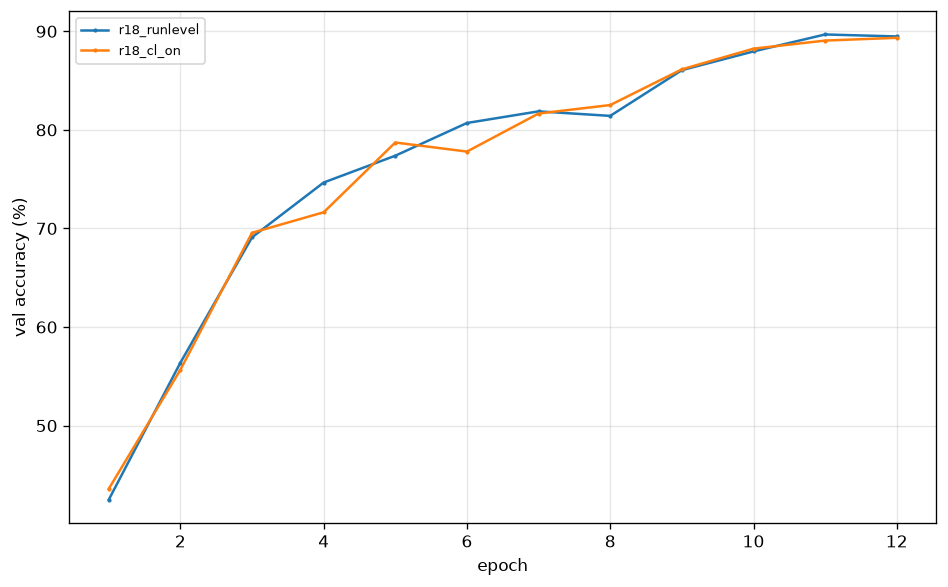
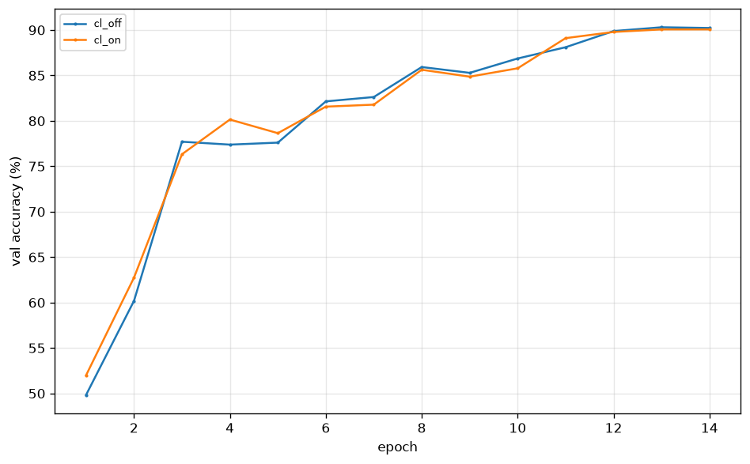

# EXPERIMENTS.md — Ablation ledger

Every training run that informs a decision gets a row here. A result you can't point to a row for doesn't count.

**Rules**
- One row per run, added when the run *finishes*, not when it's planned.
- `val_acc` is best val accuracy across epochs. Test accuracy appears only for the final model.
- Every row links to its run directory and config hash so it can be rebuilt.
- Rows that fell outside their expected band get a hypothesis in the Notes column. A surprise is data.
- Regenerate a table with `python scripts/make_report.py --all --section <id>` rather than hand-editing.
  It rewrites only between that section's `BEGIN/END GENERATED` markers; prose outside them is safe.
- **Within a sweep, the `Min` and `s/epoch` columns are not a cross-run comparison.** `sweep.py` runs
  jobs back to back, so run order is confounded with GPU temperature — the ninth run starts on a card
  the first eight have been heating, and a 12-epoch run has already been watched drift 36.2 → 40.8
  s/epoch as it warmed. **Only the accuracy columns compare across rows.** Read `GPU C in/out` before
  reading any timing column, and re-measure a timing claim as a standalone run.
- **A wrong run is retracted, never deleted.** Add `"retracted": {"reason": "...", "date": "..."}` to
  its `run_manifest.json`; the row then renders struck through with the reason still visible. A row
  that silently vanishes is worse than a wrong one in a document whose whole job is being checkable.

---

## Hardware

Fill in once, in Sprint 3, so every timing below is interpretable.

| GPU | VRAM | CPU | PyTorch | CUDA | OS |
|---|---|---|---|---|---|
| NVIDIA RTX 4060 Laptop | 8 GB | i7-14700HX | 2.11.0+cu128 | 12.8 | Windows 11 |

Laptop GPU — record whether the machine was plugged in and on the "Best performance" power profile, since thermal throttling on runs over an hour is the main source of timing variance between otherwise identical runs.

**Sprint 3 conditions:** plugged in, Best-performance profile. Under sustained load the GPU held 2580 MHz at 65–68 °C with no throttle flags set; an fp16 4096³ matmul benchmarked at 28.9 TFLOPS, so the card is delivering its clocks. No run in this sprint exceeded 4 minutes, so none of these numbers carry thermal decay.

### Measured epoch times — RUN-LEVEL

Batch 128, AMP on, `channels_last` off (ADR-007). **Run-level**: a real training run, validation and
checkpoint writes and logging included. ADR-007's table is **per-step** and is not comparable with
this one — see `PRD.md` §5. Steady state is the median of a run's back half, not
everything-but-the-first-epoch (see "the ramp is not one epoch" below).

| Model | s/epoch (steady) | Across sessions | First epoch | Measured over |
|---|---|---|---|---|
| SimpleCNN | 4.4 / 6.4 | ±20%, **not reproducible** | 62–73 s | 30 ep (sprint 3), 14 ep ×2 (sprint 4) |
| ResNet-18-CIFAR | **13.8** | ±4% (13.2–14.2) | 80–86 s | 5 ep (sprint 3), 10 + 12 ep (sprint 4) |

The first epoch costs an extra 60–75 s on Windows: `num_workers=4` on both the train and val loaders means eight worker processes spawn and each unpickles its own copy of the CIFAR-10 split. Fixed per run, so it matters at 30 epochs and disappears at 300.

**The ramp is not one epoch.** ResNet-18 settles by epoch 3; SimpleCNN takes until roughly epoch 7 —
the sprint-3 gate run went 65.6, 8.4, 7.0, 5.2, 4.7, 4.3, then flat at 4.3–4.4 for the remaining 24.
Any run shorter than ~10 epochs reports a ramp-inflated number no matter how the median is taken.

**SimpleCNN cannot be used as a timing instrument.** Identical config and commit measured 4.4 s/epoch
in one session and 6.4 in the next. ResNet-18 varied ±4% over the same period. Likely GPU boost
state — ResNet-18 saturates the card, SimpleCNN never draws enough to leave a lower power state, so
its epoch time depends on what ran before it. Run performance A/Bs on ResNet-18.

---

## Sprint 3 — Baseline

| ID | Run | Config hash | Model | Epochs | Val acc | Test acc | Min | Notes |
|---|---|---|---|---|---|---|---|---|
| E0 | `runs/simple_cnn_20260801_004212` | `939482835ef3` | simple_cnn | 30 | **93.02** (best, ep 27) | 91.55 | 3.3 | Gate M4 (≥85%) passed by 8 points. Final-epoch val 92.60 / test 91.76. |

## Sprint 5 — The 94% recipe

| ID | Run | Hash | Change from full recipe | Epochs | Val acc | Δ vs F | Min | Notes |
|---|---|---|---|---|---|---|---|---|
| F | | | — full recipe — | 120 | | — | | **Gate: ≥94.0%** |
| E1 | | | AdamW 1e-3 instead of SGD | 120 | | | | |
| E2 | | | Step LR (60,90) instead of cosine | 120 | | | | |
| E3 | | | No warmup | 120 | | | | |
| E4 | | | Weight decay applied to BN/bias | 120 | | | | |
| E5 | | | No label smoothing | 120 | | | | |
| E6 | | | weight_decay 1e-4 | 120 | | | | |
| E7 | | | 30 epochs | 30 | | | | |
| E8 | | | No crop, no flip | 120 | | | | |

## Sprint 6 — Augmentation

| ID | Run | Hash | Augmentation | Epochs | Val acc | Δ vs E9 | Min | Notes |
|---|---|---|---|---|---|---|---|---|
| E9 | | | baseline (crop+flip) | 200 | | — | | Reference for this block |
| E10 | | | + Cutout(1,16) | 200 | | | | |
| E11 | | | + Mixup α=0.2 | 200 | | | | |
| E12 | | | + CutMix α=1.0 | 200 | | | | |
| E13 | | | + Cutout + Mixup | 200 | | | | |
| E14 | | | + Cutout + CutMix | 200 | | | | |
| E15 | | | + RandAugment(2,9) + Cutout | 200 | | | | |
| E16 | | | Cutout length 8 / 16 / 20 | 200 | | | | Sensitivity sweep |

## Sprint 7 — Final

| ID | Run | Hash | Setup | Epochs | Seed | Val acc | Test acc | ECE | Min |
|---|---|---|---|---|---|---|---|---|---|
| E17 | | | best aug + EMA | 300 | 42 | | | | |
| E18 | | | best aug + EMA | 300 | 1337 | | | | |
| E19 | | | best aug + EMA | 300 | 2024 | | | | |
| E20 | | | E17 + TTA (hflip) | — | 42 | | | | |
| E21 | | | E17, no label smoothing | 300 | 42 | | | | Calibration comparison |

**Headline result:** _mean ± std over seeds 42/1337/2024, to be filled in Sprint 7._

---

## Candidate ablations

- `random_crop_padding` uses `padding_mode="reflect"` (`build_train_transform`, sprint 1). Zero padding is the
  classic recipe and is worth testing in Sprint 5.
- `channels_last` is off by default (ADR-007) because it measured 2.8× slower here run-level on ResNet-18.
  Re-measure on any other GPU before assuming that still holds — it is one config flag.
- The val loader runs `num_workers=4` to serve ten batches of 512. Four worker spawns almost certainly cost more
  than they save, and they are half of the 60–75 s first-epoch penalty. Worth measuring against `num_workers=0`
  on the eval loaders.

## Findings

**Sprint 3 — the val/test gap is mostly checkpoint selection, not a split bug.** The gate run's best checkpoint scores 93.02% val and 91.55% test, a 1.47% gap wide enough to be worth chasing. Evaluating the *final* checkpoint instead gives 92.60% val and 91.76% test — a 0.84% gap. The difference between the two gaps is the price of picking the best of 30 epochs by val accuracy: roughly 0.6% of apparent accuracy that does not survive contact with data the selection never saw. The residual ~0.85% is the genuine val/test offset, consistent with held-out train-split data being slightly easier than CIFAR-10's official test split. Nothing here indicates a transform or split defect — but it does mean **every val number in this document is optimistic by roughly half a point** relative to what the test set will say, and cross-run comparisons on val are only fair because every run pays the same tax.

**Sprint 3 — NHWC is not free.** See ADR-007. The reflex to enable `channels_last` alongside AMP is ImageNet advice; at 32×32 with CIFAR channel counts it cost 3× the wall clock on this GPU. It is worth a single measured run before adopting any "standard" performance recipe at an unusual input size.

**Sprint 4 — a six-epoch run cannot measure seconds per epoch, and this document briefly claimed otherwise.** An earlier version of this section reported that ADR-007's 2.9× `channels_last` penalty was really 2.2× run-level, and explained the gap as validation and checkpointing diluting the ratio. Both halves were wrong, and both are withdrawn. The measurement was a 6-epoch SimpleCNN A/B whose `channels_last: false` arm was still ramping — sprint 3's 30-epoch run shows SimpleCNN going 8.4, 7.0, 5.2, 4.7, 4.3 before settling at 4.4, so *every* sample in a 6-epoch run is startup transient. The explanation was wrong too: sprint 3's numbers were already run-level, from full training runs with `eval_every: 1` and `save_every: 1`, so there was never a per-step-vs-run-level gap to explain for that model. The tooling repeated the error, because `runtime.seconds_per_epoch` excluded only the first epoch; it now takes the median of the run's back half, which reports 4.4 where the old code reported 6.5.

**Sprint 4 — ADR-007 confirmed run-level, on the right model this time.** ResNet-18, 12 epochs, identical but for the flag: 13.84 s/epoch NHWC-off against 38.78 NHWC-on, a **2.80× penalty** where ADR-007's per-step benchmark predicted 2.90×. For a GPU-bound model the two kinds of number agree to within 4%, which is the useful calibration: per-step numbers are a fine proxy *when the model saturates the card*, and misleading when it does not. Val accuracy came out 0.34% in NHWC-off's favour, which at 12 epochs is noise and is not evidence either way. One incidental observation — the NHWC arm's epoch times drift upward across the run (36.2 → 40.8 s) while the NHWC-off arm stays flat, consistent with the heavier arm being the only one that runs the card hot enough to throttle. Anything measuring a sustained 45-minute recipe should expect that drift; nothing in sprints 3–4 ran long enough to see it before.

**Sprint 4 — ResNet-18's budget is sound, and re-measuring it is what proved the rest wrong.** Re-measured run-level across three sessions (5, 10 and 12 epochs), ResNet-18 holds 13.2–14.2 s/epoch against sprint 3's 13.6. The 120-epoch recipe is ~29 minutes, comfortably inside M3's 45, and the sprint 5 sweep is ~4.4 h. Nothing in the budget moves. The useful discovery was the opposite of the one being looked for: **SimpleCNN's epoch time is not reproducible across sessions** — 4.4 in one, 6.4 in the next, identical config and commit — while ResNet-18 varies ±4% over the same window. The plausible mechanism is GPU boost state, since ResNet-18 saturates the card and SimpleCNN does not draw enough to leave a lower power state. The practical rule is that the cheap model is the untrustworthy instrument: measure performance on the one that loads the hardware.

**Sprint 4 — the gate found a resume bug that no accuracy number would have.** Ctrl-C used to write `last.pth` from a half-finished epoch under that epoch's number, so resuming skipped it and left the LR schedule short of `min_learning_rate` (ADR-009). Nothing in a metrics file looks wrong when this happens — the run reports its full epoch count and a plausible curve. It took an explicit "kill it and resume it" step in the gate to see it, which is an argument for gates that exercise the failure paths rather than only the happy one.

Write these as you go, in prose, one short paragraph each. The table holds the numbers; this section holds the understanding. Candidates that usually turn out to be worth writing up:

- How much basic augmentation (crop + flip) is actually worth. Expect the largest single delta in the whole document.
- Cosine vs step LR at equal epochs.
- The cost of applying weight decay to BN and bias parameters.
- Whether mixup/cutmix helped at 120 epochs vs 200 — and why the answer differs.
- Label smoothing's effect on accuracy vs its effect on calibration.
- Seed-to-seed variance, and what that implies about how precisely any single-run CIFAR number should be read.

---

## Generated tables

Regions below marked `BEGIN GENERATED` are rewritten wholesale by
`scripts/make_report.py --section <id>`. Everything outside them — every finding, hypothesis and
table above this line — is never touched by the generator (ADR-010). Write prose outside a region;
it will survive any number of regenerations.

<!-- BEGIN GENERATED: sprint-4-channels-last -->
## Sprint 4 - channels_last A/B, run-level (ResNet-18-CIFAR, 12 epochs)

| Run | Hash | channels_last | Best val acc | Best epoch | s/epoch | GPU C in/out | Min | Status |
|---|---|---|---|---|---|---|---|---|
| `runs/r18_runlevel` | `408a9d82636a` | False | 89.68 | 11 | 13.84 | -/- | 4.2 | completed |
| `runs/r18_cl_on` | `d60ad5395da4` | True | 89.34 | 12 | 38.78 | -/- | 8.8 | completed |

*Generated by `make_report.py --section sprint-4-channels-last`. Edits inside this region are overwritten; write findings outside it.*
<!-- END GENERATED: sprint-4-channels-last -->

<!-- BEGIN GENERATED: sprint-4-superseded -->
## Sprint 4 - superseded: channels_last A/B on SimpleCNN (retracted)

| Run | Hash | channels_last | Best val acc | Best epoch | s/epoch | GPU C in/out | Min | Status | Retracted |
|---|---|---|---|---|---|---|---|---|---|
| ~~`runs/cl_off`~~ | `0342e5ce1f30` | False | ~~90.30~~ | 13 | ~~6.43~~ | -/- | 2.8 | completed | 2026-08-01: SimpleCNN is not a reproducible timing instrument -- its epoch time varies 4.4-6.4 s across sessions on identical config (see Findings). Superseded by the ResNet-18 A/B. |
| ~~`runs/cl_on`~~ | `50365b497b89` | True | ~~90.06~~ | 13 | ~~14.3~~ | -/- | 4.4 | completed | 2026-08-01: SimpleCNN is not a reproducible timing instrument -- its epoch time varies 4.4-6.4 s across sessions on identical config (see Findings). Superseded by the ResNet-18 A/B. |

*Generated by `make_report.py --section sprint-4-superseded`. Edits inside this region are overwritten; write findings outside it.*
<!-- END GENERATED: sprint-4-superseded -->
